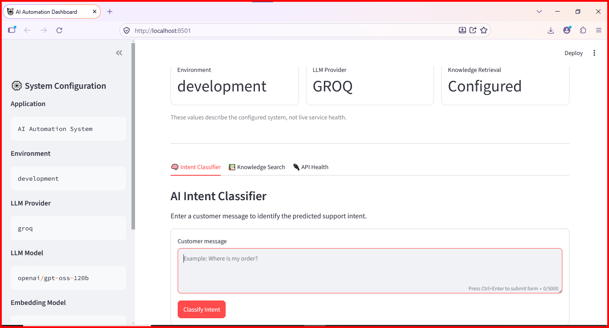
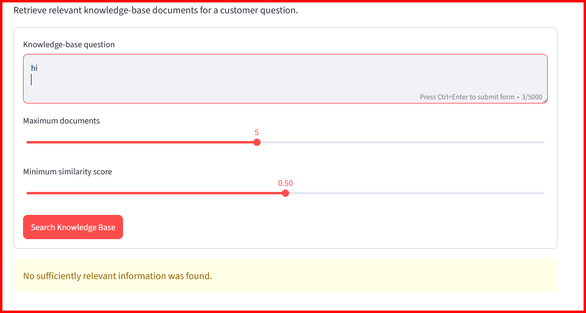

# 🤖 AI Customer Support Automation System

An AI-powered customer support automation system built with Python. This project is designed to classify customer messages, generate helpful responses, and automate common customer support workflows.

The system combines AI-powered intent classification, response generation, API integration, and a Streamlit dashboard to provide a foundation for intelligent customer support automation.

---
## ✨ Demo Link

👉 **[Launch AI Customer Support Automation](https://customer-support-automation-zahyu5sg6hxnomxprrjfwh.streamlit.app/)**
## ✨ Features

- 🤖 **AI Intent Classification** — Identifies customer intents such as order status, return requests, refund requests, and order-related issues.
- 💬 **AI Response Generation** — Generates helpful customer support responses using a configured language model.
- 🛍️ **Customer Support Workflows** — Supports common customer service scenarios.
- 🧠 **Retrieval-Augmented Generation (RAG)** — Supports knowledge retrieval where configured.
- 🔌 **API Integration** — Supports backend API functionality where implemented.
- 📊 **Interactive Dashboard** — Provides a Streamlit interface for interacting with the application.
- 🛡️ **Error Handling** — Includes handling for errors and unexpected inputs.
- 🧪 **Automated Testing** — Uses pytest to test application components.
- ⚙️ **Environment Configuration** — Keeps API credentials and configuration in environment variables.

---

## 🧰 Tech Stack

| Technology | Purpose |
|---|---|
| Python | Core application logic |
| Streamlit | Interactive dashboard |
| FastAPI | Backend API, if configured |
| LangChain | LLM/RAG integration, where used |
| Groq / OpenAI | Language-model integration, depending on configuration |
| Vector Database | Knowledge retrieval, where configured |
| Pytest | Automated testing |
| Git & GitHub | Version control and project hosting |

---

## 📸 Screenshots

### Dashboard



### Error Handling



---

## 📁 Project Structure

```text
AI Customer Support Automation/
│
├── ai/
│   ├── classifier.py
│   ├── generator.py
│   └── prompts.py
│
├── screenshots/
│   ├── dashboard.png
│   └── error-handling.png
│
├── .streamlit/
│   └── config.toml
│
├── app.py
├── config.py
├── requirements.txt
├── .env
├── .gitignore
└── README.md
```

Additional directories and modules may be present in the repository.

---

## ⚙️ Installation and Setup

### 1. Clone the Repository


git clone https://github.com/Nirbhay1612/Customer-Support-Automation.git


Navigate to the project directory:


cd customer-Support-Automation


### 2. Create a Virtual Environment


python -m venv venv


### 3. Activate the Virtual Environment

For Windows PowerShell:


.\venv\Scripts\Activate.ps1


### 4. Install Dependencies


python -m pip install --upgrade pip
pip install -r requirements.txt


---

## 🔑 Environment Configuration

Create a `.env` file in the root directory of the project.

Add the environment variables required by your application's `config.py`.

For example, if your configuration uses Groq:


LLM_PROVIDER=groq
GROQ_API_KEY=your_groq_api_key_here
GROQ_MODEL=openai/gpt-oss-120b
LLM_TEMPERATURE=0.2
LLM_TIMEOUT=30
LLM_MAX_RETRIES=2


**Important:** These are example settings. Use the exact environment-variable names expected by your project's configuration and the model currently supported by your provider.

Never publish real API keys, passwords, tokens, or other secrets on GitHub. Keep your `.env` file private and ensure it is listed in `.gitignore`.

---

## ▶️ Run the Application

### Start the Streamlit Dashboard

From the project root, run:


streamlit run app.py


Streamlit will display a local URL in the terminal. Open that URL in your browser to access the dashboard.

### Start the FastAPI Backend

If your project contains `app/main.py` and defines a FastAPI instance named `app`, run this command in a separate terminal:


uvicorn app.main:app --reload


If your FastAPI entry point is located elsewhere, adjust the command to match the actual file and application variable.

---

## 🧪 Run Tests

Run the complete test suite:


pytest -v


To run a particular test file:


pytest tests/test_ai.py -v


Use the test files and paths that actually exist in your repository.

---

## 🛡️ Security and Best Practices

- Store API keys in environment variables.
- Never commit your `.env` file or other sensitive information.
- Keep dependencies updated.
- Validate user input before processing it.
- Handle API errors and unexpected responses safely.
- Use mock responses for tests that should not make real API calls.
- Review authentication and permissions before exposing APIs publicly.

---

## 🚀 Future Improvements

- Add support for additional customer intents.
- Improve AI response accuracy.
- Expand automated test coverage.
- Add more customer support integrations.
- Improve logging and monitoring.
- Add authentication and rate limiting where required.
- Deploy the application to a suitable hosting platform.

---

## 👨‍💻 Author

**Nirbhay Tembhurne**

- GitHub: [@Nirbhay1612](https://github.com/Nirbhay1612)
- Repository: [AI Customer Support Automation](https://github.com/Nirbhay1612/Customer-Support-Automation)

---

## 📄 License

A license has not been specified in this README. Add a `LICENSE` file if you intend to distribute the project under a particular open-source license.

---

⭐ If you find this project useful, consider giving the repository a star!